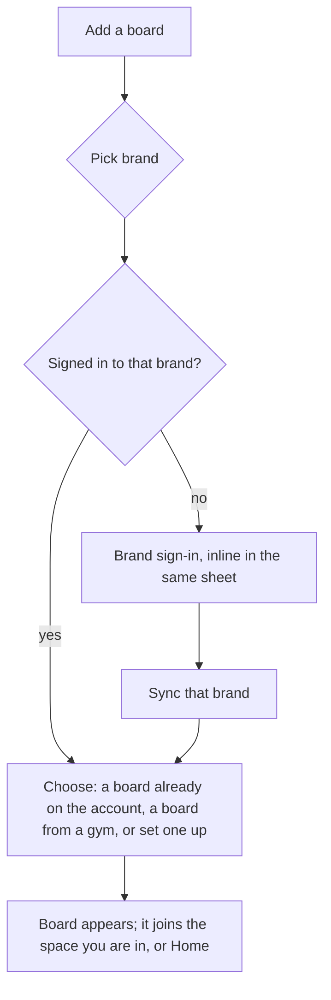

# Multiple providers and accounts: UX

Status: proposal. Nothing here is built beyond the data layer (`src/core/provider.ts`, `logicalCircuits.ts`, `mergedLog.ts`).

## Principles

1. **The board is the unit, not the account.** People say "my board at home" and "the wall at the gym". Accounts sit behind boards and are never a thing you switch.
2. **Native inside a board, unified across boards.** Anything that belongs to one provider (browsing its climbs, filters, setting, workouts, leaderboards, its social features) looks and behaves like that provider's own app. Anything that is about *you* (log, stats, suggestions, circuits, timer, export) spans boards.
3. **Routing is automatic.** Every action goes to the provider of the climb or board it concerns, with that provider's stored session. The user never picks an account to act as.
4. **One failure stays one failure.** An expired session, a down server or a missing account affects only that provider's boards, with a local banner. Everything else keeps working.
5. **Local first.** Cross-board data lives on the device (no Slackboard server), is exportable, and survives a provider disappearing.

## Concepts the user sees

| Concept | Meaning | Where it appears |
|---|---|---|
| **Board** | A physical wall setup (brand, layout, size, hold sets, angle). The unit you open. | Climb tab header, board sheet |
| **Space** | A place with one or more boards: Home, or a gym. Created automatically from board locations; renameable. | Board sheet, gym banner |
| **Account** | A login on one provider. Shown only in You > Accounts and when something needs attention. | You tab |
| **Circuit** | A named list of climbs. May mix boards; may be *kept on* a provider. | Circuits |

"Provider" is an internal word; the UI says the brand name ("Tension Board", "Decoy Board", "MoonBoard").

## Flows

### First launch: "What do you climb on?"

No "sign in" wall. Tiles for each brand. Picking one goes to that brand's sign-in (brand name, accent colour, its terms and forgot-password link), then the sync screen, then the boards on that account appear. A user with a Tension and a Decoy board does the same flow twice; there is no concept of a primary account.

### Adding another account is just adding a board

Add a board > pick a brand you have no account for > sign in inline > continue. The same sheet handles "I have no account": the brand's create-account step, no mailing list. Nothing asks "switch account".

### Daily use: you never choose an account

| You do | It goes to |
|---|---|
| Log a send or attempt on a climb | that climb's provider, using its session; queued per provider if offline |
| Like, block, report, set, publish | that climb's provider |
| Edit a circuit | the local circuit, then each provider copy that holds those climbs |
| Open a shared link (`tensionboardapp2.com/climbs/...`) | the app, in the matching provider's context |
| See stats, suggestions, the log | all boards at once |

The log sheet shows a quiet footer, "Logging to Decoy Board as @you", so the destination is visible without being a decision. No account for that provider: the sheet offers "Sign in to log this" (or "Keep on this phone").

### Switching boards (not accounts)

- Swipe the board name (built) or open the board sheet, now grouped by space.
- At a gym with several boards, a **space bar** under the header shows its boards as small tabs; one tap switches. The Climb list, angle, filters and Bluetooth link all follow the board, each remembering its own state.
- Opening a climb from a circuit or a suggestion shows it in *its* board's native view even if that is not the open board.

### Gym with multiple boards

1. **Spaces are automatic, and renameable.** The user never creates a Space. Boards are grouped by *where they are*, and the name defaults to the gym's name (from the provider's gym pin) or "Home".
   - **Distance sanity check.** Two boards join the same Space only if their locations are within a short distance (start at 200 m; one constant). A MoonBoard in one gym and a Tension Board in another across the world never pair, whatever their names. Names are never used on their own to pair boards, only as a tie-break between boards that are already close.
   - **Where a board's location comes from.** A board added from a gym pin takes the pin's coordinates. A board with no pin (a home board) takes the phone's location the first time it is added or opened with location available, stored as the board's home point. A board with no location at all gets its own Space until it has one.
   - **Renaming.** A Space's name is editable (long-press its name). Once renamed it keeps the name when boards join or leave. A user can also move a board to another Space by hand; that choice overrides the automatic grouping for that board.
2. **Detection is location only.** Opening the app near a Space (within the same radius) shows "At {Space}: {boards}" and offers its boards first; far from every Space nothing changes and the last board stays open. It never switches boards silently mid-task. Bluetooth is not used for detection.
3. **Gym session.** The first log in a space starts a session, ending after a long idle. The Log tab shows it as one card ("Saturday, 14 sends on 2 boards, hardest V5"), not separate per-brand lists.
4. **Next-up.** Suggestions run across the boards in that space ("Warm up on Decoy V2s, then a V5 reach on Tension"), with board chips to narrow.
5. **Bluetooth follows you.** Switching boards disconnects the previous controller and connects the next (auto-connect rules apply per brand), with the bulb dot showing state per board.
6. **Shared timer.** Rest timers belong to the session, not a board.
7. **Mixed warm-up circuit.** A local circuit spanning the boards in a gym; the circuit screen shows a provider dot on each climb.

## Where features live

| Lives inside a board (native to its provider) | Spans boards (Slackboard) |
|---|---|
| Climb list, filters, search, sort | Log (merged), edit/delete entries |
| Climb view, grades in that brand's notation | Stats widget and Stats screen |
| Set a climb, drafts, publish | Suggestions, Workout shortcut, Timer |
| Provider circuits' social side: public/private, followers, share link | Circuits list and editor (local, with "kept on" per provider) |
| Explore, leaderboards, activity, follows, news | Export, import, backup |
| Workout AI (a provider service) | Space and gym session |

Capabilities gate the board-native column: a provider without leaderboards simply has no leaderboards row; MoonBoard shows hold-tap filters and foot rules, Aurora shows angle and hold sets.

## Staying native to each provider

- **Vocabulary.** A `vocab` table per provider (climb/problem, circuit/list, send/ascent, benchmark/classic). The Climb tab says what that brand's own app says.
- **Notation.** Grades render in the board's own scale in its views; the shared scale appears only in cross-board views (stats, suggestions), labelled with the board's own grade next to it.
- **Mechanics.** Angle dial only when the board is adjustable; foot-only role only where the provider has it; the board is drawn from that provider's geometry and art.
- **Identity cue.** The board dot (already built) is the only brand colour in chrome. No provider logos; brand names are text.

## Cross-board circuits, concretely

- Create from any climb: the default is "Keep on {that climb's provider}", which is exactly what that provider's own app would do. Add a foreign climb later and a one-line note says it stays on this phone.
- A "Kept on" row in circuit details: chips per provider with Off / Private / Public. Off on an existing copy asks first.
- A circuit changed in the official app is merged back on the next sync; a provider deleting its copy leaves the circuit here as phone-only with a note.

## Accounts screen (You > Accounts)

One row per account: brand, username, last sync, state (OK, Sign in again, Offline). Actions: Sync now, Sign out. Sign out asks what to do with data: "Remove {Brand} data from this phone" (default) or "Keep"; local circuits and the cross-board log entries from that brand are kept either way, marked "From a signed-out account".

## Edge cases

- **Climb of a provider you have no account for** (e.g. from a shared circuit): viewable read-only; logging prompts the inline sign-in.
- **Expired session:** banner on that brand's boards only, with a Sign in again button; queued changes wait.
- **Duplicate gym boards across brands:** distinct boards, one space.
- **Grade comparability:** a note on first view of cross-board stats, "Grades from different boards are matched by V grade; boards differ."
- **Privacy:** no data leaves the phone except to the provider the action concerns. Say so on the Accounts screen.

## Build order

1. Per-provider sessions and database files; `Board.provider` already in place.
2. Brand picker, inline sign-in, Accounts screen; second provider (Decoy or Grasshopper).
3. Spaces (automatic grouping with the distance check, renaming), board sheet grouping, space bar; location-based detection.
4. Gym session in the merged Log; space-scoped suggestions.
5. Bluetooth multi-controller handoff.

## Open questions

- Do we offer an optional encrypted backup of local circuits, or only export/import?
