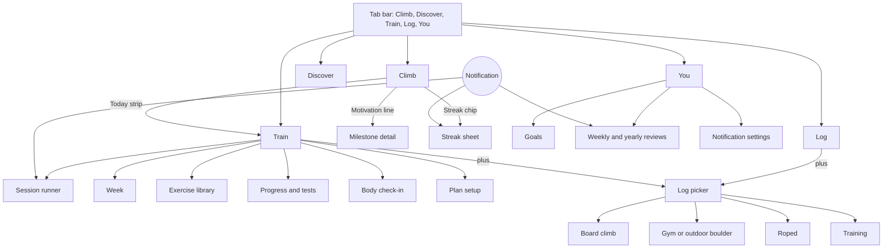
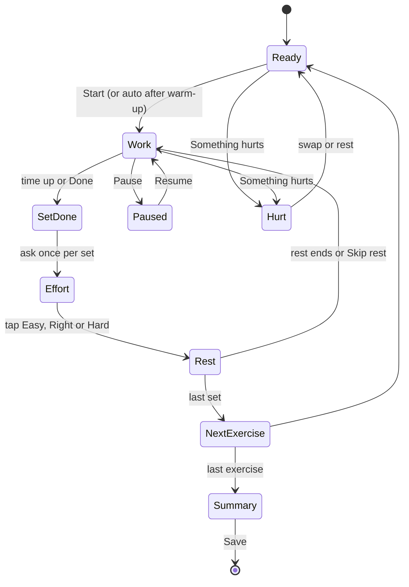
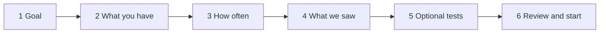

# Train, roped, streaks, goals and reviews: UX plan

Status: **draft for review**. Nothing here is built. The behaviour is in [../docs/FUTURE_PLANS.md](../docs/FUTURE_PLANS.md) and the code
changes are in [../docs/IMPLEMENTATION_PLAN.md](../docs/IMPLEMENTATION_PLAN.md). This document is how it should feel to use.

## 1. Who is using it, and where

The main place is **the gym floor**: chalky hands, one hand free, glancing at the screen between efforts, often in poor light, and
usually in the middle of a session. That sets the rules for everything below.

1. **Never make the user type** where a tap will do. Recents, last-time prefill, steppers and chips come first.
2. **Three taps to log, two to start.** Repeating a roped route is two taps. Starting today's planned session is two taps.
3. **Big targets, big numbers.** At least 48 px targets, a countdown readable at arm's length.
4. **Calm.** No red, no scolding, no streak anxiety. Good news is celebrated once; bad news is rarely shown at all.
5. **Always explainable.** Anything the app decides (a plan, a lighter day, a nudge) has a one-tap "Why?".
6. **Interruptible.** Leaving mid-session loses nothing; the timer is based on timestamps, not a running counter.
7. **One idea per place.** Climb is what to climb, Train is what to do to get stronger, Log is what happened, You is progress and settings.

## 2. Navigation



- **Tab bar:** Climb (mountain), Discover (magnifier), **Train (flexed biceps)**, Log (list), You (person). Labels stay one short word so five fit on a small phone.
- The Train tab is on by default and can be hidden in Settings. Hidden, its screens are still reached from the Climb tab's Today strip and from notifications.
- **One "+ Log" picker** is the way to add anything (below), from the Log tab and the Train tab.

## 3. The Climb tab: three small additions, one row of height

The Climb tab's top is already crowded (a past complaint), so the additions must not grow it. All of it sits **inside the scrolling list header**, not pinned.

```
+------------------------------------------------------------+
|  5  sends in 30 days                          V4   >       |   existing widget
|  3 more V4s until you have 10                    [x]       |   new: one line, same card
+------------------------------------------------------------+
|  [ 9 days  M T W T F S S ]   Today: max hangs, then rope > |   new: one row
+------------------------------------------------------------+
```

- **Motivation line**: sits in the existing widget card as a second line, with a small progress bar under it. Tap opens the milestone detail. The `x` hides it for today. Nothing shows when there is nothing true to say.
- **Today strip**: one row, two parts. Left, the **streak chip** with seven dots for the week (filled for a climbing day, a hollow dot for a rest day that is keeping the streak alive, empty for nothing). Right, a **plan summary** that opens the Train tab. With no plan, the right side is absent. With a rest day planned it reads "Rest day. Your streak is safe."
- **Rest nudge**: replaces the plan summary for the day when it applies, as a dismissible line ("2 days in a row. A lighter day helps you recover."), with "Why?" and "Not today".
- **Mondays**: the Today strip shows "Your week is ready" until the review is opened.

## 4. The Train tab

### 4.1 States

| State | What the user sees |
|---|---|
| **New** (no plan, no history) | A short welcome and three buttons: *Build me a plan*, *Just log training*, *Browse exercises*. Nothing is forced |
| **Has a plan, session planned** | Today card with the session, the week strip, and what is next |
| **Rest day** | "Rest day." A line on why it helps, the next session, and a quick body check-in button |
| **Done today** | A quiet summary of what was logged, then the week strip |
| **Behind or missed** | No message about it. The week simply shows the session as *moved* or *skipped* and the next one as today's |
| **Plan paused** | One banner with *Resume*, used for injury, travel or a break |
| **Log only** (no plan) | Recent sessions and the library, with the plus button |

### 4.2 The Train home (plan active)

```
Train                                              [ + ]
+------------------------------------------------------+
|  TODAY  Max hangs and pull-ups               ~45 min |
|  Max hangs  3 x 10 s   62.5 kg                       |
|  Weighted pull-ups  4 x 5   +10 kg                   |
|  Hanging leg raises  3 x 8                           |
|  [ Start ]                         Swap   Skip   Why? |
+------------------------------------------------------+
|  This week                                           |
|  Mon  Roped + max hangs   done                       |
|  Tue  Pull and core       done                       |
|  Wed  Bouldering                                     |
|  Thu  Rest                                           |
|  Fri  Max hangs + laps    > Today                    |
|  Sat  Rest                                           |
|  Sun  Bouldering                                     |
+------------------------------------------------------+
|  Exercises     Progress     Body check-in            |
+------------------------------------------------------+
```

- **Start** goes straight into the runner. **Swap** offers 2 to 4 alternatives that train the same quality. **Skip** asks nothing and marks it skipped. **Why?** expands the reasons ("Fingers are rested: 72 hours since your last hang").
- Days the user climbs outside the plan (roped, bouldering) appear in the week as the user's own days, not as plan items, so the week reads as one picture.
- Tapping a day opens a sheet: *Move to another day*, *Skip*, *Make it lighter*. No drag-and-drop (it is hard to do accurately and not accessible). Moving shows the constraint that applies ("Too close to Wednesday's hard session") and offers the nearest good day.

### 4.3 The session runner

A full-screen mode with the screen kept awake. One exercise at a time.



```
Max hangs                              3 of 5 sets
+------------------------------------------------+
|                                                |
|                    0:07                        |   big countdown
|                  HANG  10 s                    |
|                                                |
|     20 mm  half crimp   62.5 kg   (+18.5)      |
+------------------------------------------------+
|   [ Done ]                     [ Pause ]       |
|   Something hurts                              |
+------------------------------------------------+
```

- **Phases are tied to the existing timer** and announced three ways at once: a haptic (a different pattern for hang start, last 3 seconds and rest end), a large colour-and-label change, and a screen-reader announcement. Sound is not used (the gym is noisy and phones are muted).
- **After each set**, three big chips: *Easy*, *Right*, *Hard* (a long press opens an exact margin in seconds for people who time it). That one tap drives the next set's load and the next session. It is optional; ignoring it keeps the plan as it was.
- **Rest** shows the time left and the next set's load, with *+30 s* and *Skip rest*. If the app is backgrounded, one local notification fires at the end of the rest.
- **Something hurts** is on every runner screen. It asks the area (fingers, elbow, shoulder, other) and *achy* or *sharp*, then offers: swap for a gentler exercise, stop finger work for today, or end the session. It writes a body note. It never argues.
- **Leaving** is safe: the session is saved as it goes, and reopening resumes the same set. *Finish early* saves what was done and marks the rest as skipped.
- **Summary**: what was done against the plan, any new best ("Best hang yet: 62.5 kg"), the optional session effort (1 to 10, one row of chips), and a one-tap body check-in. Then *Save*, which is also where a milestone or goal celebration appears (once).

### 4.4 Plan setup (first time, about two minutes)

Six steps, each with a sensible default so *Next* always works, and each can be done later.



1. **Goal**: *Get stronger in general* (default), a grade, a project, or a dated trip with a date picker.
2. **What you have**: hangboard, weights, pull-up bar, campus board, gym access (chips). Body weight (needed for load advice) and units.
3. **How often**: days per week (a stepper), minutes per session, and which days are already roped and bouldering days (tap the week).
4. **What we saw in your logs**: the style profile in plain words with the numbers behind it ("Your overhang grade is 3 below your slab grade. Your board grades are below your gym grades. That points to strength work.") and a correction control ("That's not right"). The user's answer outranks the logs. With too little data this step says so and moves on.
5. **Optional tests**: *Test now*, *Test later*, or *Use safe defaults*. The defaults are conservative and clearly labelled.
6. **Review and start**: the first block in one screen (weeks, phases, what a week looks like) and *Start*. Nothing is final: the plan can be edited or rebuilt from the Train tab.

The **test flow** is a guided screen using the timer: choose the edge and grip, add weight, hang 7 seconds, record, rest 5 minutes, repeat up to 5 times, and it reports the result and the loads it will use. It can be skipped at any step.

### 4.5 Exercises, progress and body

- **Library**: a search box and category chips (finger strength, endurance, pulling, power, core, antagonist and shoulder, mobility). Each row shows the name, equipment and last-time summary.
- **Exercise detail**: a short how-to, a safety note, the fields it uses, a "Last time" and "Best" line, a small chart over time, and *Add to today*.
- **Progress**: per-exercise charts, test results over time with the change since the last test, and, near the end of a block, a *Retest* prompt. Charts reuse the existing chart components.
- **Body check-in**: a sheet with area chips (fingers, elbows, shoulders, other) that cycle *fine, sore, hurts*, a 1 to 5 energy row and a note. It is offered at the end of a session and from the Train tab. It never appears as a pop-up, and there is never a reminder for it.

## 5. Logging

### 5.1 The "+ Log" picker

A bottom sheet, from the plus on the Log tab or the Train tab:

```
Log
[ Board climb ]   [ Boulder, gym or outdoor ]
[ Roped ]         [ Training ]
Recent
 5.10c sport, indoor, redpoint     (Roped)
 V3 overhang, flash                (Gym)
 Max hangs 3 x 10 s                (Training)
```

The *Recent* rows repeat a past entry in one tap (it opens the form pre-filled, with the date set to now). The board-climb option opens the climb list, because a board send is logged from the climb itself.

### 5.2 The roped form

One screen, no scrolling for the common case:

```
Roped
Style      [ Sport ] Trad  Top rope  Autobelay
Where      [ Indoor ] Outdoor        Adventure Rock
Grade      YDS | French     5.9  5.10a  5.10b [5.10c] 5.10d  5.11a ...   (coloured strip)
Result     Onsight  Flash  [Redpoint]  Fell  Hung  Project
Tries      [ - ]  1  [ + ]
More details  v   (length, pitches, route name, link, note)
[ Save ]            [ Save and another ]
```

- **Grade strip** reuses the horizontal strip from the boulder log. The system toggle is remembered, and both grades are shown on the chosen one.
- **Autobelay** swaps *Result* for a count stepper ("x6 at 5.10c"), because volume is the point.
- **Save and another** keeps the form and resets only the result and tries, so a session of laps is a tap each.
- The date defaults to now with a small *Change* control (the existing date picker).

### 5.3 Training entries

Opened from a plan session, from the library, or from the picker. A set table with one row per set:

```
Max hangs  (20 mm, half crimp)
Set   Load        Time    
 1    62.5 kg     10 s    [done]
 2    62.5 kg     10 s    [done]
 3    [-] 62.5 [+] [-] 10 [+]   Copy last   [add set]
Effort (optional)  1 2 3 4 5 6 7 [8] 9 10
```

Pre-filled from last time ("last: +18.5 kg, 10 s, 20 mm"), editable with steppers, *Copy last set* adds a row identical to the previous one. A planned session pre-fills the target instead. Entering a session by hand after the fact works the same way.

## 6. The Log tab: one timeline

- **Day cards**, newest first, replace today's session cards. A card shows the day, the place, and a one-line summary: "6 routes, hardest 5.10c · 8 boulder sends · max hangs". Expanding lists the entries, each with its **kind icon** (board, boulder, roped, training) so kinds are told apart by shape, not only colour.
- **Filter chips**: All, Board, Boulders (off-board), Roped, Training. The range control (Day, Week, Month, Year, All) stays.
- Editing, deleting and undo behave as they do now for every kind.
- The "Gym and outdoor climbs" row goes away: it is a filter now.
- The header numbers (sessions, sends, climbs) follow the chosen filter. The per-grade bars show boulder grades; with the Roped filter they show roped grades.

## 7. Streaks, motivation, goals and reviews

### 7.1 Streak

- The chip on the Climb tab shows the count and the week dots. Tapping it opens a sheet with **the last eight weeks as a small calendar**, the current and longest streak, the span, and the state in words: *Climbed today*, *Rest day is fine*, *Today keeps it going*, or *Longest: 14 days* after a break (no negative wording).
- Hollow dots between filled ones are labelled "rest day, keeps your streak" for people who have not seen the rule. A short "How streaks work" line explains the one-day gap.

### 7.2 Motivation (default, no goals needed)

- One line a day, on the Climb tab (section 3), plus the toast after logging when the logged grade is the one that moved ("3 more V4s until you have 10").
- *Why am I seeing this?* shows the rule ("You have 7 V4 sends and the next milestone is 10"). A *Don't show these* switch is in Settings.
- Never compares with other people and never says the user is behind.

### 7.3 Goals

- **You > Goals**: a list of cards with a progress ring and a plain sentence ("7 of 10 V4s, by 31 Dec"). *New goal* starts with templates (*Send my first V5*, *Climb 3 days a week*, *A 10-day streak*, *Train fingers twice a week*) and *Custom*. A template is one screen: scope, window, target, *Save*.
- A completed goal shows a quiet card with the date and, once, the confetti and a *Next goal?* sheet that offers a sensible follow-up in one tap.
- A goal that is close to done takes priority over a default milestone on the Climb tab.

### 7.4 Reviews

- **Weekly review**: a single scrolling screen of four or five cards (*Your week in numbers*, *Highlight*, *Training*, *How it compares with your recent average*, *Next week*) with *Share* (the existing share-image machinery). An empty week gets one friendly line and no charts.
- **Yearly review**: the same pattern with sections (totals, grade pyramid by discipline, a month heatmap, best week, top climbs, most-used board or gym, milestones and goals) and a *Share* image.
- **Where they are found**: You > Reviews, the Monday Today strip, and the Monday notification.

## 8. Notifications

### 8.1 Asking permission

Never at install. The first time the user turns on a reminder type, a screen explains in two lines what they will get and how often ("At most one a day, quiet at night, all on this phone"), then the system prompt appears. A "no" is remembered and the settings screen then shows how to enable it in system settings, with no repeated prompts.

### 8.2 Settings (You > Settings > Notifications)

```
Notifications         system permission: allowed
Today's plan          [on]   at 17:30
Weekly review         [on]   Monday at 08:00
Streak, last day      [off]
Rest day note         [off]
Milestone reminder    [off]
Quiet hours           21:00 to 08:00
[ Send a test notification ]
```

Each line has a one-sentence description. A footer says delivery may be late when the phone is saving battery.

### 8.3 What a notification says

Short, specific, no exclamation marks except a milestone, no guilt, and never about a missed day:

- Today's plan: "Today: max hangs, then roped volume."
- Weekly review: "Your week is ready: 5 days, 14 sends, a new V1 on the board."
- Streak, last day: "Today keeps your 12-day streak going."
- Rest end (during a session only): "Rest is over. Set 4 of 5."

Tapping opens the matching screen. A notification for something already done is cancelled before it fires.

## 9. Settings and the first run

- **Settings** gains: Train tab (on or off), Units, Motivation lines (on or off), Rest nudges (Off, Relaxed, Standard, Keen), and Notifications. Everything defaults to on or standard, except the notification types.
- **Existing users** see the new tab with a small dot, once. The Train tab's empty state is the only explanation. No tour, no pop-ups.
- **New users** see no change until they log something, then the Climb tab's Today strip appears after the first logged climb.

## 10. Copy

Plain, short and concrete, in the style of the existing app. Examples to keep consistent:

| Place | Text |
|---|---|
| Rest nudge | "2 days in a row. A lighter day helps you recover." |
| Planned light day | "Today is a planned light day. You're on track." |
| Streak, resting | "Rest day. Your streak is safe." |
| Pain | "Sharp finger pain: stop hard finger work for now. If it lasts, see a physio." |
| Style profile | "Your overhang grade is 3 below your slab grade. Strength work should help." |
| Empty week | "No climbing this week. Rest counts too." |
| Plan note | "These numbers are general guidance, not medical advice." |

Words to avoid: "failed", "missed", "behind", "lost your streak", "you should", and anything that blames the user.

## 11. Accessibility

- All targets at least 48 px; the runner's main buttons are larger. Text follows the system size, and the countdown scales with it.
- Every phase change in the runner is announced (a polite live region) and has a haptic and a visual change, so no single sense is required.
- Colour is never the only cue: kind icons, chip labels and text accompany every colour.
- Reduce-motion turns off confetti, the progress animation and screen transitions on the milestone card.
- Moving a session uses a sheet, not dragging. Charts have a text summary ("Best hang rose from 55 to 62.5 kg over 8 weeks").
- The runner and forms work with a screen reader and with large text, checked on a small screen.

## 12. Motion and haptics

| Moment | Haptic | Visual |
|---|---|---|
| Hang starts | Strong tick | Phase label turns bright |
| Last 3 seconds | Three light ticks | Numerals pulse once a second |
| Rest starts or ends | Soft tick | Label changes |
| Set marked easy, right or hard | Selection tick | Chip fills |
| New best, goal or milestone | Success pattern | Confetti once, honours reduce motion |
| Pain flagged | Warning tap | The sheet slides in; no animation beyond that |

Everything respects the existing haptics setting and reduce motion.

## 13. Edge cases and states

| Case | Behaviour |
|---|---|
| App killed or phone locked mid-session | The runner restores to the same set; the clock is based on timestamps |
| System clock or time zone changes | Days come from entry dates; a running timer uses elapsed time, not wall-clock |
| A long break (weeks) | The plan rebuilds from today with a gentle first week; nothing is "caught up" |
| Injury, travel, illness | *Pause plan* in one tap; resuming offers a lighter first week |
| Deleting or editing an entry | Streaks, milestones, goals and the plan recompute; an achieved goal stays achieved |
| No data yet | Every card has an honest empty state; no empty charts |
| Notifications denied | Everything works; the settings screen says how to enable them |
| Very large log | Lists are virtualised; aggregates are computed once per change |
| Small phones | Checked at the smallest emulator profile with large text |

## 14. How I would check it

**Task targets** (counted on the emulator and the phone):

| Task | Target |
|---|---|
| Log a roped route with the same grade as the last | 2 taps |
| Log a new roped route | 5 taps or fewer, no typing |
| Start today's planned session | 2 taps |
| Run a 5-set hang session | One tap per set (plus the optional effort) |
| Log a training session after the fact | 6 taps or fewer, no typing for a repeat |
| Move a session to another day | 3 taps |
| Report pain mid-session | 3 taps |
| Find the streak rule | 2 taps |

**Process:**

1. Build the new screens first with **fixture data** (a developer-only switch), review them on the emulator at two screen sizes, and fix the layout before wiring any logic.
2. Walk each flow above at **normal and large text**, with a screen reader on, and with **reduce motion** on.
3. On the phone: the runner in a real session, haptics, and notifications (permission, schedule, cancel, tap-through, quiet hours).
4. A last **copy pass** against the word list in section 10.

## 15. Open UX questions

1. **Plan card on the Climb tab**: just the Today strip, or also a small week strip? I lean to the strip only, to keep the tab uncrowded.
2. **Runner sound**: none at all, or an optional beep for the last 3 seconds? Gyms are loud, so I lean to none.
3. **Effort chips**: *Easy, Right, Hard* on every set, or only after the first and last? Every set gives the planner more to learn from, at the cost of one tap each.
4. **Streak calendar**: eight weeks or the whole year? Eight weeks keeps it small; a year is better as part of the yearly review.
5. **Body check-in prompt**: only after a session, or also once a day when the app opens? I lean to after a session and from the Train tab only.
